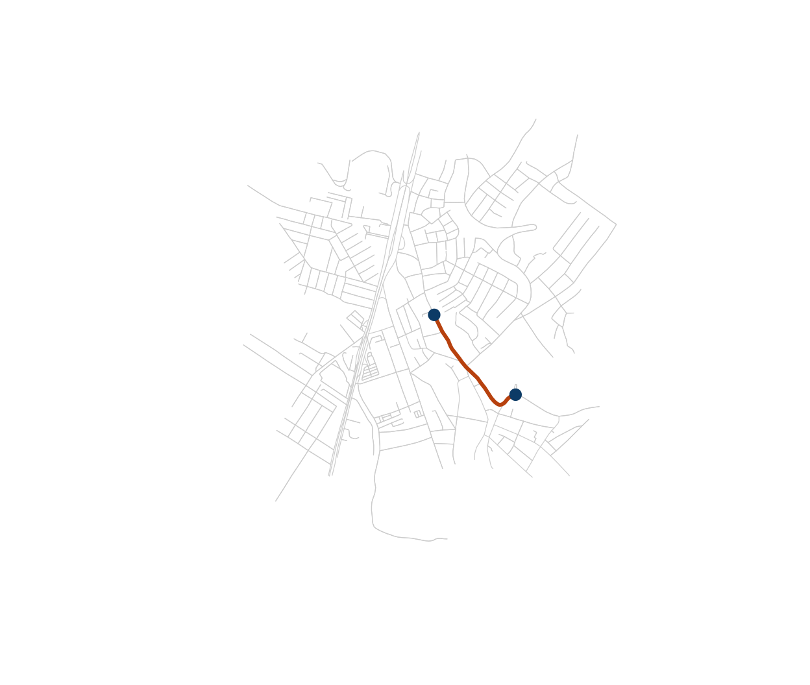
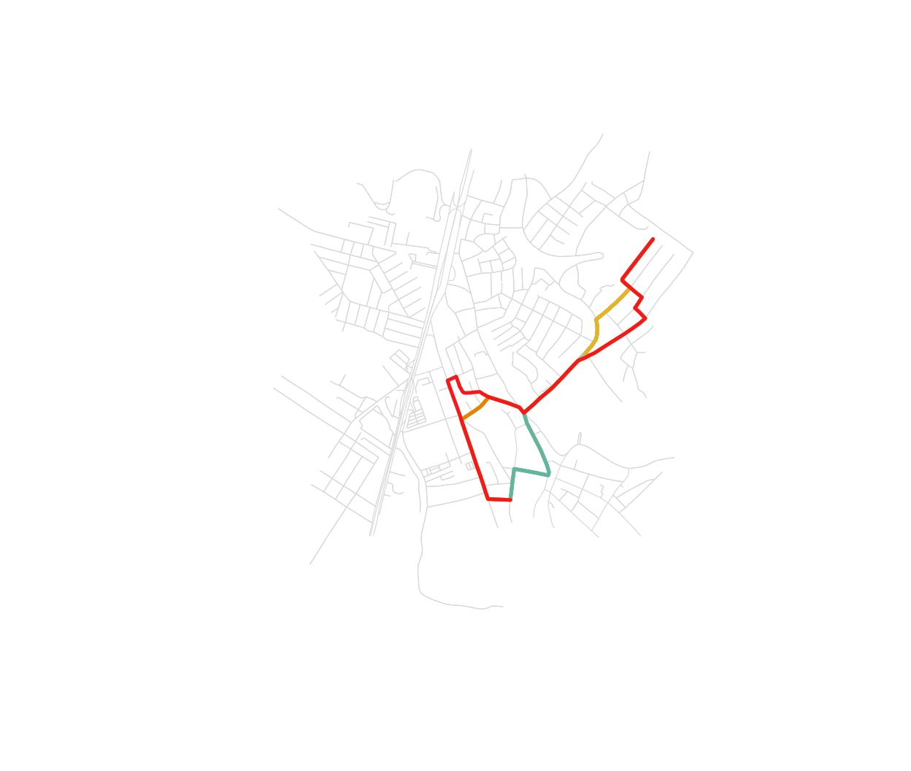
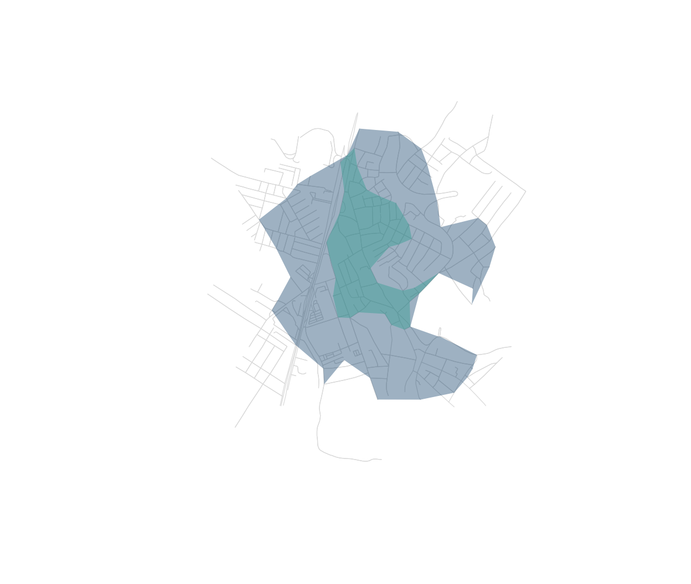

# Routing and isochrones

``` r

library(osmnxr)
g <- ox_example("olinda")
```

Routing in `osmnxr` runs in the Rust core (Dijkstra, Yen, multi-source).
We use the bundled real network of central Olinda, Brazil, so this runs
offline.

## Shortest path by distance

Snap two coordinates to the nearest nodes, then route between them:

``` r

orig <- ox_nearest_nodes(g, x = -34.8553, y = -8.0089)
dest <- ox_nearest_nodes(g, x = -34.8505, y = -8.0125)
route <- ox_route_shortest(g, orig, dest, weight = "length")
route
#> Simple feature collection with 1 feature and 3 fields
#> Geometry type: LINESTRING
#> Dimension:     XY
#> Bounding box:  xmin: -34.85537 ymin: -8.013207 xmax: -34.85157 ymax: -8.009047
#> Geodetic CRS:  WGS 84
#> # A tibble: 1 × 4
#>   route  cost path                                                      geometry
#>   <int> <dbl> <list>                                            <LINESTRING [°]>
#> 1     1  680. <dbl [8]> (-34.85537 -8.009047, -34.85526 -8.009268, -34.85499 -8…
```

The result is an `sf` tibble: the route’s cost, the node `osmid`s
traversed and its merged street geometry, ready to map.
([`ox_shortest_path()`](https://strategicprojects.github.io/osmnxr/reference/ox_shortest_path.md)
returns just the vector of node ids, when that is all you need.)

``` r

plot(g, col = "grey80", lwd = 0.6)
plot(sf::st_geometry(route), col = "#b7410e", lwd = 3, add = TRUE)
route_xy <- sf::st_coordinates(g$nodes)[match(route$path[[1]], g$nodes$osmid), ]
points(route_xy[c(1, nrow(route_xy)), ], pch = 19, col = "#0d3b66", cex = 1.2)
```



## Travel time instead of distance

Real routing usually minimises *time*, not distance. Impute free-flow
speeds from each road’s class, derive per-edge travel times, then route
on them (Boeing 2025, `routing` module):

``` r

g <- ox_add_edge_travel_times(g)
head(g$edges[c("highway", "length", "speed_kph", "travel_time")])
#> Simple feature collection with 6 features and 4 fields
#> Geometry type: LINESTRING
#> Dimension:     XY
#> Bounding box:  xmin: -34.85889 ymin: -8.00763 xmax: -34.85675 ymax: -8.006154
#> Geodetic CRS:  WGS 84
#>       highway    length speed_kph travel_time                       geometry
#> 1       trunk 143.05987        80    6.437694 LINESTRING (-34.85776 -8.00...
#> 2       trunk  39.20625        80    1.764281 LINESTRING (-34.85716 -8.00...
#> 3 residential 108.81964        30   13.058356 LINESTRING (-34.85716 -8.00...
#> 4 residential 108.81964        30   13.058356 LINESTRING (-34.85675 -8.00...
#> 5    tertiary  47.55902        40    4.280311 LINESTRING (-34.85867 -8.00...
#> 6    tertiary  47.55902        40    4.280311 LINESTRING (-34.85889 -8.00...

route_t <- ox_shortest_path(g, orig, dest, weight = "travel_time")
# may differ: the fastest route is not always the shortest
identical(route_t, route$path[[1]])
#> [1] TRUE
```

## Route alternatives

`ox_route_shortest(k = ...)` returns the *k* shortest loopless routes
(Yen’s algorithm) — useful for comparing options or modelling
redundancy:

``` r

ox_route_shortest(g, orig, dest, k = 3, weight = "travel_time")
#> Simple feature collection with 3 features and 3 fields
#> Geometry type: LINESTRING
#> Dimension:     XY
#> Bounding box:  xmin: -34.8567 ymin: -8.013207 xmax: -34.85157 ymax: -8.009047
#> Geodetic CRS:  WGS 84
#> # A tibble: 3 × 4
#>   route  cost path                                                      geometry
#>   <int> <dbl> <list>                                            <LINESTRING [°]>
#> 1     1  72.1 <dbl [8]>  (-34.85537 -8.009047, -34.85526 -8.009268, -34.85499 -…
#> 2     2  90.7 <dbl [11]> (-34.85537 -8.009047, -34.85526 -8.009268, -34.85499 -…
#> 3     3 111.  <dbl [16]> (-34.85537 -8.009047, -34.85526 -8.009268, -34.85499 -…
```

## Routing with road preferences

Often the best route is not simply the fastest one: a dispatcher may
want to keep trucks off residential streets, a cyclist may want to stay
on them.
[`ox_add_edge_penalties()`](https://strategicprojects.github.io/osmnxr/reference/ox_add_edge_penalties.md)
turns that preference into a per-edge column — here, the metres each
edge spends on calm residential road classes:

``` r

g <- ox_add_edge_penalties(g, c(residential = 1, living_street = 1))
head(g$edges[c("highway", "length", "penalty")])
#> Simple feature collection with 6 features and 3 fields
#> Geometry type: LINESTRING
#> Dimension:     XY
#> Bounding box:  xmin: -34.85889 ymin: -8.00763 xmax: -34.85675 ymax: -8.006154
#> Geodetic CRS:  WGS 84
#>       highway    length  penalty                       geometry
#> 1       trunk 143.05987   0.0000 LINESTRING (-34.85776 -8.00...
#> 2       trunk  39.20625   0.0000 LINESTRING (-34.85716 -8.00...
#> 3 residential 108.81964 108.8196 LINESTRING (-34.85716 -8.00...
#> 4 residential 108.81964 108.8196 LINESTRING (-34.85675 -8.00...
#> 5    tertiary  47.55902   0.0000 LINESTRING (-34.85867 -8.00...
#> 6    tertiary  47.55902   0.0000 LINESTRING (-34.85889 -8.00...
```

The *soft* version just folds the penalty into the routing weight (an
ordinary shortest path that trades seconds against residential metres at
a fixed rate). The interesting questions, though, are *hard*: what is
the fastest route using **at most** some budget of residential metres,
and what does the whole trade-off curve look like?
[`ox_route_pareto()`](https://strategicprojects.github.io/osmnxr/reference/ox_route_pareto.md)
answers the second — it enumerates every Pareto-optimal route exactly
(bicriteria label-setting in the Rust core; one-way streets respected):

``` r

o2 <- ox_nearest_nodes(g, x = -34.85445, y = -8.01503)
d2 <- ox_nearest_nodes(g, x = -34.84853, y = -8.00431)
front <- ox_route_pareto(g, o2, d2, weight = "travel_time", resource = "penalty")
front[c("cost", "resource")]
#> Simple feature collection with 6 features and 2 fields
#> Geometry type: LINESTRING
#> Dimension:     XY
#> Bounding box:  xmin: -34.85706 ymin: -8.01503 xmax: -34.84853 ymax: -8.00431
#> Geodetic CRS:  WGS 84
#> # A tibble: 6 × 3
#>    cost resource                                                        geometry
#>   <dbl>    <dbl>                                                <LINESTRING [°]>
#> 1  190.    1328. (-34.85445 -8.01503, -34.85442 -8.014768, -34.85437 -8.014349,…
#> 2  191.    1296. (-34.85445 -8.01503, -34.85442 -8.014768, -34.85437 -8.014349,…
#> 3  193.     983. (-34.85445 -8.01503, -34.85538 -8.014993, -34.85548 -8.014706,…
#> 4  193.     952. (-34.85445 -8.01503, -34.85538 -8.014993, -34.85548 -8.014706,…
#> 5  197.     747. (-34.85445 -8.01503, -34.85538 -8.014993, -34.85548 -8.014706,…
#> 6  213.     583. (-34.85445 -8.01503, -34.85538 -8.014993, -34.85548 -8.014706,…
```

Each successive route is a little slower and a little calmer; no other
route beats any of them on both criteria. Plotted, the alternatives fan
out between the fast arterial option and the quiet residential one:

``` r

plot(g, col = "grey85", lwd = 0.6)
cols <- grDevices::hcl.colors(nrow(front), "Zissou 1")
plot(sf::st_geometry(front), add = TRUE, col = cols, lwd = 2.5)
```



[`ox_route_constrained()`](https://strategicprojects.github.io/osmnxr/reference/ox_route_constrained.md)
answers the first question — the exact constrained shortest path for one
chosen budget:

``` r

best <- ox_route_constrained(g, o2, d2, weight = "travel_time",
                             resource = "penalty",
                             budget = stats::median(front$resource))
best[c("cost", "resource")]
#> Simple feature collection with 1 feature and 2 fields
#> Geometry type: LINESTRING
#> Dimension:     XY
#> Bounding box:  xmin: -34.85649 ymin: -8.01503 xmax: -34.84853 ymax: -8.00431
#> Geodetic CRS:  WGS 84
#> # A tibble: 1 × 3
#>    cost resource                                                        geometry
#>   <dbl>    <dbl>                                                <LINESTRING [°]>
#> 1  193.     952. (-34.85445 -8.01503, -34.85538 -8.014993, -34.85548 -8.014706,…
```

On metro-sized networks where enumerating the exact front gets
expensive, `ox_route_constrained(..., method = "lagrangian")` solves the
same problem by Lagrangian relaxation — a handful of plain Dijkstra runs
— returning a feasible route together with a proven lower bound on the
optimal cost (a message reports the duality gap whenever optimality is
not certified).

(For a road that is temporarily closed, don’t penalize it — mask it:
drop the edge, or set its weight to `Inf`, before routing.)

## Isochrones (service areas)

An isochrone is the area reachable from an origin within a budget. With
`travel_time` as the weight, cutoffs are in seconds — here, 1- and
2-minute drive-time service areas from a central point:

``` r

centre <- ox_nearest_nodes(g, x = -34.8553, y = -8.0089)
iso <- ox_isochrone(g, centre, cutoffs = c(60, 120), weight = "travel_time")
iso[c("cutoff", "n_nodes")]
#> Simple feature collection with 2 features and 2 fields
#> Geometry type: POLYGON
#> Dimension:     XY
#> Bounding box:  xmin: -34.86146 ymin: -8.016166 xmax: -34.84852 ymax: -8.001461
#> Geodetic CRS:  WGS 84
#>   cutoff n_nodes                       geometry
#> 1    120     368 POLYGON ((-34.86141 -8.0064...
#> 2     60     104 POLYGON ((-34.85679 -8.0048...
```

``` r

plot(g, col = "grey85", lwd = 0.6)
plot(sf::st_geometry(iso), add = TRUE, border = NA,
     col = grDevices::adjustcolor(c("#0d3b66", "#2a9d8f"), 0.4))
```



## Many-to-many distances

For accessibility work you often need a full origin–destination matrix
in one call (see the
[Accessibility](https://strategicprojects.github.io/osmnxr/articles/accessibility.md)
article):

``` r

hubs <- ox_nearest_nodes(g,
  x = c(-34.8553, -34.8505, -34.852),
  y = c(-8.0089, -8.0125, -8.006))
round(ox_distance_matrix(g, hubs, hubs, weight = "travel_time"))
#>            8945592343 1206764895 1499391454
#> 8945592343          0         72         73
#> 1206764895         76          0        134
#> 1499391454         73        129          0
```

## Blending new stops into the network

Routing starts and ends at nodes, but real origins and destinations
rarely sit on one —
[`ox_nearest_nodes()`](https://strategicprojects.github.io/osmnxr/reference/ox_nearest_nodes.md)
above quietly moved them to the closest intersection.
[`ox_blend()`](https://strategicprojects.github.io/osmnxr/reference/ox_blend.md)
does better: it snaps each point onto its nearest *edge* and splits the
edge there (in both directions of a two-way street), turning the exact
location into a routable node — the `osmnxr` counterpart of
[`sfnetworks::st_network_blend()`](https://luukvdmeer.github.io/sfnetworks/reference/st_network_blend.html),
computed in the Rust core:

``` r

stops <- sf::st_sfc(
  sf::st_point(c(-34.8540, -8.0095)),
  sf::st_point(c(-34.8512, -8.0118)),
  crs = sf::st_crs(g$nodes)
)
gb <- ox_blend(g, stops)
gb$meta$blend # which node each stop became, and how far it was snapped
#> # A tibble: 2 × 5
#>   point       node     dist          u          v
#>   <int>      <dbl>    <dbl>      <dbl>      <dbl>
#> 1     1 9016535993 0.000206 1572693772 9016123129
#> 2     2 9016535994 0.000575 1206764895 7272379949

ox_route_shortest(gb, gb$meta$blend$node[1], gb$meta$blend$node[2],
                  weight = "travel_time")
#> Simple feature collection with 1 feature and 3 fields
#> Geometry type: LINESTRING
#> Dimension:     XY
#> Bounding box:  xmin: -34.85411 ymin: -8.013207 xmax: -34.85153 ymax: -8.009675
#> Geodetic CRS:  WGS 84
#> # A tibble: 1 × 4
#>   route  cost path                                                      geometry
#>   <int> <dbl> <list>                                            <LINESTRING [°]>
#> 1     1  82.4 <dbl [8]> (-34.85411 -8.009675, -34.8541 -8.00968, -34.85398 -8.0…
```

[`ox_blend()`](https://strategicprojects.github.io/osmnxr/reference/ox_blend.md)
also accepts a whole second `osm_graph` (say, a metro layer over a
street network): every node of the second graph is snapped into the
first, the two graphs are stacked with
[`ox_union()`](https://strategicprojects.github.io/osmnxr/reference/ox_union.md),
and *connector* edges are added between each snapped pair — producing
one routable multimodal graph. The blend is steerable on both sides —
`snap_nodes` flags which points (or `y` nodes) may snap, `snap_edges`
which edges of the network may receive them — and `connector_node_attrs`
copies node attributes of the second graph (a per-station access time,
say) onto its connector edges. See
[`?ox_blend`](https://strategicprojects.github.io/osmnxr/reference/ox_blend.md)
for the details.

## References

Boeing, G. (2025). Modeling and analyzing urban networks and amenities
with OSMnx. *Geographical Analysis*.
