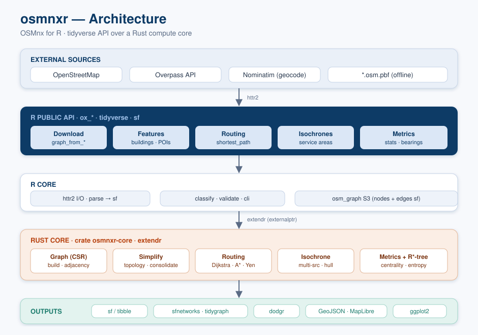
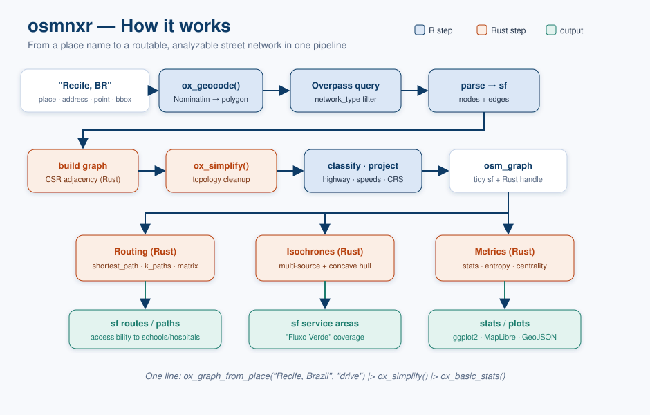

# osmnxr

**osmnxr** is an **R port of [OSMnx](https://osmnx.readthedocs.io/)**,
the Python library created by [Geoff Boeing](https://geoffboeing.com/),
to **download, model, simplify, analyze and visualize** street networks
and other geospatial features from
[OpenStreetMap](https://www.openstreetmap.org/). The interface, the
modelling choices and the Overpass queries are OSMnx’s, translated to a
tidyverse-friendly R API: the design is Geoff Boeing’s work, and this
package is its translation. If you use osmnxr, please [cite
OSMnx](#citation).

> osmnxr is an independent project: it is not affiliated with,
> maintained by or endorsed by the OSMnx project or its author. The port
> was written with the assistance of AI coding tools (see [How this port
> was made](#how-this-port-was-made)).

It is a port, not a Python wrapper. Heavy graph computation (routing,
simplification, metrics) runs in the bundled **Rust** crate
[osmnxr-core](https://strategicprojects.github.io/osmnxr-core/) via
[extendr](https://extendr.rs/), so there is no Python runtime to manage.
Everything you get back is tidy [`sf`](https://r-spatial.github.io/sf/).

## Installation

Install the released version from CRAN (macOS and Windows binaries need
no Rust; building from source needs the **Rust toolchain**,
[rustup](https://rustup.rs/), version 1.81 or later — the crates it
depends on come with the package, nothing is downloaded):

``` r

install.packages("osmnxr")
```

Or the development version from GitHub (always builds from source):

``` r

# install.packages("remotes")
remotes::install_github("StrategicProjects/osmnxr")
```

## Quick start

``` r

library(osmnxr)

# Download a drivable street network for a place
g <- ox_graph_from_place("Olinda, Brazil", network_type = "drive")
g
plot(g)

# Route between two points (Rust Dijkstra)
from <- ox_nearest_nodes(g, x = -34.85, y = -8.01)
to   <- ox_nearest_nodes(g, x = -34.84, y = -8.00)
ox_shortest_path(g, from, to)

# Urban metrics
ox_basic_stats(g)
ox_orientation_entropy(g)   # street-grid order/disorder
```

No network access? Explore the whole API offline with a synthetic grid:

``` r

g <- example_osm_graph()
ox_basic_stats(g)
ox_shortest_path(g, ox_nearest_nodes(g, 0, 0), ox_nearest_nodes(g, 300, 300))
```

## How it works

`osmnxr` is split into a tidy R API over a Rust compute core:



The pipeline, from a place name to an analyzable network:



## Related work

`osmnxr` complements the R geospatial stack — it can hand graphs to
[`sfnetworks`](https://luukvdmeer.github.io/sfnetworks/),
[`tidygraph`](https://tidygraph.data-imaginist.com/) and
[`dodgr`](https://urbananalyst.github.io/dodgr/), and downloads via the
same Overpass API used by
[`osmdata`](https://docs.ropensci.org/osmdata/).

## Citation

osmnxr is a port of OSMnx, so the work to cite is OSMnx:

> Boeing, G. (2025). Modeling and Analyzing Urban Networks and Amenities
> with OSMnx. *Geographical Analysis*, 57(4), 567–577.
> <doi:%5B10.1111/gean.70009>\](<https://doi.org/10.1111/gean.70009>)

`citation("osmnxr")` gives this reference first, followed by the entry
for the R package itself.

## How this port was made

osmnxr translates [OSMnx](https://github.com/gboeing/osmnx) (MIT, ©
Geoff Boeing) to R: function names (`graph_from_place` becomes
[`ox_graph_from_place()`](https://strategicprojects.github.io/osmnxr/reference/ox_graph_from_place.md)),
network types, default settings, the Overpass filters (reproduced tag
for tag), topology simplification, intersection consolidation and the
urban metrics all follow the original, and each release is checked for
parity against OSMnx. The translation was done by the package authors
with the assistance of AI coding tools; the R code and the Rust core
were written for this package rather than copied line by line, but the
intellectual contribution of the design is that of OSMnx’s author. The
OSMnx copyright and license notice ships with the package in
`inst/COPYRIGHTS`.

A few things are not in OSMnx and are this package’s own: Pareto-optimal
and constrained routing, travelling-salesman routes,
[`ox_union()`](https://strategicprojects.github.io/osmnxr/reference/ox_union.md)/[`ox_blend()`](https://strategicprojects.github.io/osmnxr/reference/ox_blend.md),
isochrones, and the converters to `sfnetworks`, `tidygraph`, `dodgr` and
MapLibre. Differences from OSMnx’s behaviour are bugs in the port:
please report them
[here](https://github.com/StrategicProjects/osmnxr/issues), not to the
OSMnx project.

## Acknowledgements

To [Geoff Boeing](https://geoffboeing.com/), for
[OSMnx](https://osmnx.readthedocs.io/) and for a decade of maintaining
it in the open. The data come from the
[OpenStreetMap](https://www.openstreetmap.org/) contributors and the
public [Overpass](https://overpass-api.de/) and
[Nominatim](https://nominatim.openstreetmap.org/) services.

Thanks to everyone who files issues — user reports shape this package.
[Srikanth Komala Sheshachala (@talegari)](https://github.com/talegari)
proposed
[`ox_union()`](https://strategicprojects.github.io/osmnxr/reference/ox_union.md)
for multimodal routing (#1),
[`ox_route_tsp()`](https://strategicprojects.github.io/osmnxr/reference/ox_route_tsp.md)
for travelling-salesman routes (#4), constrained / Pareto-optimal
routing with road preferences (#5) and
[`ox_blend()`](https://strategicprojects.github.io/osmnxr/reference/ox_blend.md)
for snapping points and whole graphs into a network (#6); his careful
reports with reproducible benchmarks also led to automatic retries on
transient Overpass failures (#2), a ~250× faster graph-building phase on
metro-sized extracts (#3), and the session edge-index cache plus the
[`ox_route_shortest()`](https://strategicprojects.github.io/osmnxr/reference/ox_route_shortest.md)
interface (#5 feedback).

## License

MIT © André Leite and contributors / StrategicProjects. OSMnx, which
this package ports, is MIT © 2016–2026 Geoff Boeing; its notice is
reproduced in
[`inst/COPYRIGHTS`](https://strategicprojects.github.io/osmnxr/inst/COPYRIGHTS).
